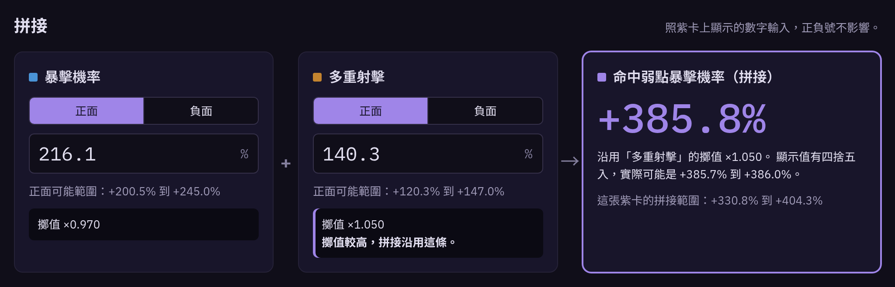

# 紫卡拼接計算機 · Riven Splice Calculator

https://pekka1117.github.io/riven-splice/

Warframe 拼接器（Riven Splicer）的計算工具。輸入紫卡上兩條屬性的數字，直接算出拼接後的數值；設定目標值，則會列出兩條屬性各要洗到多少。「屬性範圍」分頁列出每種紫卡所有屬性的正面／負面範圍，以及各屬性能拼接成什麼；輸入紫卡上的數字可查擲值百分位，洗出兩條拼不起來的好屬性時用來決定鎖哪條。

A calculator for Warframe's Riven Splicer. Enter the two traits on your riven to get the spliced value, or set a target to see how high each trait needs to roll. The Trait ranges tab lists every trait's buff and curse range for each riven type, and what it splices into; type a value there to read its roll percentile and see which of two traits that don't splice together to lock.

## 規則

- 拼接不會重新擲值：拼接屬性沿用兩條被消耗屬性中擲值較好的那一條，再套上自己的基礎係數。
- 負面屬性的數字越大代表擲值越高，拼出來反而越好。
- 公式照 [wiki Riven Mods](https://wiki.warframe.com/w/Riven_Mods#Spliced_Values)：`v = b × 10 × (rank + 1) × 1.2 × L × W`，以 32 位元浮點逐步計算。傾向自 44.1.3 起固定為 1.2×。
- 一般屬性係數、各紫卡類型可出現的屬性與只會正面/負面的註記，同樣取自 [wiki Riven Mods](https://wiki.warframe.com/w/Riven_Mods#Overview_Table) 的表格；wiki 是唯一資料來源。

## 開發

單一檔案、無相依套件。`index.html` 是頁面本體，`./build.sh` 會把它包成完整文件輸出到 `docs/`（GitHub Pages 從 `main` 分支的 `/docs` 發布）。
